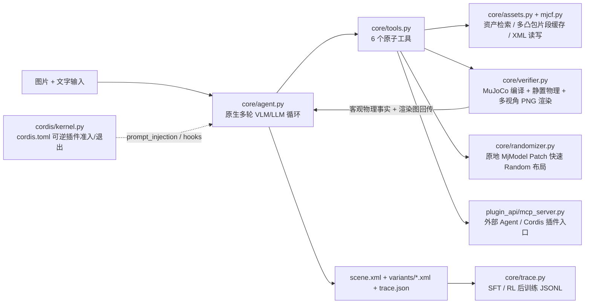

# SceneFactory v2 架构说明

SceneFactory v2 是一个极简、独立、对 AI 友好可读的 **Scene-to-MJCF 引擎**：

> **输入「图片 + 文字」→ VLM/LLM 自主多轮工具调用 + MuJoCo 客观物理/视觉反馈 → 快速低成本输出高保真 MuJoCo XML、Random 布局变体与可直接用于后训练的原生 Trace。**

---

## 核心设计原则

1. **场景生成与仿真执行彻底解耦**
   - `scene_factory/` 核心只做一件事：产出高保真、物理稳定、可随机化的 MuJoCo XML（类似 Docker 镜像构建器），对外通过 CLI / Python / MCP 插件暴露给任何外部 Agent。
   - 机器人动态控制、轨迹回放、VLA 策略、Isaac 机械臂执行、Web 队列全部隔离在 [`extensions/`](../extensions/README.md)，与核心零耦合。
2. **真 Agent，而非 Workflow（可转后训练 Trace）**
   - 不做“出一个 bad case 就焊死一段代码拦截”的脆弱规则树，也不把 LLM 锁死在单轮严格枚举表单。
   - **假设 LLM 具备规划与自纠能力**：给模型极简工具集和客观 MuJoCo 物理诊断 + 多视角离屏渲染图，让它自主生成、看图对比、反思修改。
   - 每一次运行自动落盘 `trace.json`（`scene_factory.agent_trace.v2`），包含完整多模态上下文、工具调用、物理自纠轨迹与客观裁判分，可通过 `scene-factory export-sft` 直接转为 SFT/RL 后训练数据集。
3. **Cordis 风格插件微内核管理约束的“准入与退出”**
   - 所有提示词引导或技术护栏均挂载在 `scene_factory/cordis/` 的可逆 `PluginScope` 内，由 [`config/cordis.toml`](../config/cordis.toml) 声明启用/退出。
   - 优先使用 `prompt_injection` 插件引导 Trace，而非代码硬拦截；每个插件强制标注 `added_for_model` 与 `exit_criteria`，模型升级后一键设 `enabled = false` 或 `--no-plugins` 即可退出旧约束，直接吃满模型红利。

---

## 系统分层与数据流

---

## 目录一览（核心仅 16 个文件）

| 路径 | 职责 |
| :--- | :--- |
| `scene_factory/core/agent.py` | 原生多模态多轮 Agent 主循环（零硬编码 workflow 拦截） |
| `scene_factory/core/llm.py` | 零依赖 OpenAI-compatible 多模态（图文）+ Tool Calling 客户端 |
| `scene_factory/core/tools.py` | 6 个原子工具：`search_assets` / `insert_asset` / `write_xml` / `edit_xml` / `verify_xml` / `randomize_xml` |
| `scene_factory/core/assets.py` | 读取 `data/assets/registry.jsonl` 与多部分凸包 `geometry.json`，生成高仿 MJCF 片段 |
| `scene_factory/core/mjcf.py` | 基础 XML 骨架、片段合并、内容寻址增量片段缓存 `FragmentCache` |
| `scene_factory/core/verifier.py` | 纯客观 MuJoCo 裁判（编译、静置位移/穿透/掉落检测、纯标准库多视角 PNG 渲染） |
| `scene_factory/core/randomizer.py` | 面向任意 MuJoCo XML 的确定性 Random 布局与物理参数变体（原地 `MjModel` patch 免重复编译） |
| `scene_factory/core/trace.py` | 后训练 Trace 录制与 `export_sft_jsonl` 导出 |
| `scene_factory/cordis/kernel.py` | Cordis 风格可逆插件微内核（`Context` / `PluginScope` / LIFO `effect` 卸载） |
| `scene_factory/cordis/loader.py` | 从 `config/cordis.toml` 或 `.json` 装载/退出插件 |
| `scene_factory/cordis/plugins/` | 可选插件示例：`prompt_hints.py`（提示引导）、`xml_guard.py`（技术安全护栏） |
| `scene_factory/plugin_api/mcp_server.py` | 零依赖标准 MCP (JSON-RPC 2.0 stdio) 服务端，供外部 Agent 挂载 |
| `scene_factory/spatial/geometry.py` | 免渲染/免引擎 XML SE(3) 嵌套坐标系解析、3D OBB SAT 碰撞/悬空检测与 S-Space 相机系投影 |
| `scene_factory/spatial/benchmark.py` | 3 级难度 XML-Spatial-Collision Benchmark 生成器（平铺 / 父子嵌套 / 旋转多部件 Minimal Pairs + token span） |
| `scene_factory/spatial/sspace_probe.py` | 对接 `mirros-lab/s-space` 的 6D 盒内编程碰撞读出、跨模态子空间对齐与右逆激活干预算法 |
| `scene_factory/cli.py` | 极简 CLI：`generate` / `verify` / `randomize` / `spatial-check` / `benchmark-xml` / `assets` / `plugins` / `export-sft` / `mcp` |
| `extensions/` | 隔离归档的 v1 动态控制、Isaac 后端、精细装配、Web 与历史测试 |
