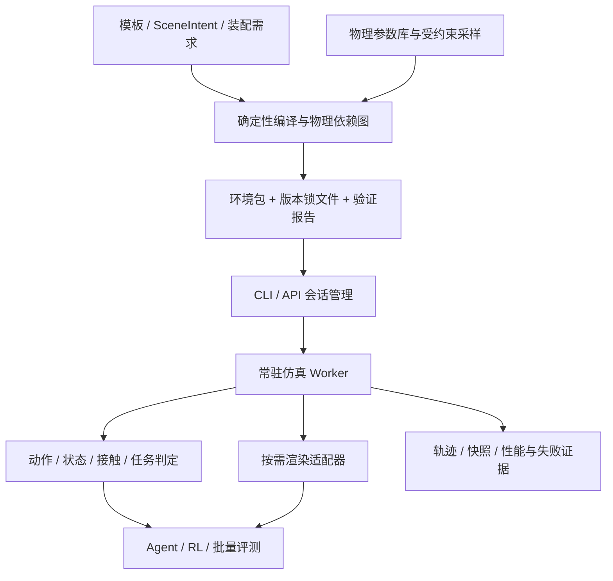

# SceneFactory 物理 AI 沙盒优化方案

日期：2026-10-28。依据：当前工作区源码、项目文档与公开项目资料。本文件是设计建议，新增接口、性能目标和里程碑均未实现或实测；本次没有运行新的仿真验收。

## 1. 核心决策

把 SceneFactory 的下一阶段定位为：**面向机器人训练与评测的可复现物理环境编译器和快速运行沙盒**。

输入是场景模板、资产、装配约束、物理参数和任务；输出是锁定版本的环境包，以及可由 agent/RL 客户端调用的运行会话。会话提供动作步进、物理状态、图像、接触信息、重置和结果证据。

优先投入 CLI/API、物理资产与装配约束、实例级随机化和运行性能。渲染采用现有引擎或外部渲染器，新页面建设不进入本轮关键路径。

对“下一代模型不需要碰撞检测也能完成组装”的回答：模型可以改进几何布局和装配方案生成，但训练环境仍需要明确的质量、惯量、接触响应、动作接口、任务判据及可重复实验条件。本项目的技术主线应建立在这些能力之上。生成阶段是否需要碰撞检查，与动力学仿真是否需要求解接触是两个问题。

**建议验证的候选创新：任务约束驱动的物理依赖图、局部增量编译与验证，以及满足约束的物理参数随机化。** CLI、容器、缓存、自动化本身属于工程基础；候选机制能否支撑专利，需现有技术检索和对照实验后判断。

## 2. 当前基础与真实缺口

| 方向 | 可复用基础 | 必须补齐的能力 |
| --- | --- | --- |
| 房间场景 | 厨房、餐厅、客厅配方，支撑、柜架收纳、预留通道；已有十余物体的房间布局 | 20/50/100 物体的性能和稳定性基准、房间内局部任务、任务工作空间约束 |
| 精细组装 | Franka 抓杯/搬放的参考环境验收记录，关节语义和交互区域契约 | 完整三维姿态、零件配合坐标系、间隙/公差、装配顺序、插入与接触判据、可执行控制接口 |
| 随机化 | seed 驱动布局，批量生成、分层配额、去重和数据划分 | episode 级随机化、实例级物理参数、相关性约束、难度分层和实际采样值记录 |
| 沙盒运行 | CLI、HTTP 作业、本地 reset/step/render、独立子进程、超时回收和证据校验 | 会话 API、任意受支持策略动作、温启动、逻辑状态恢复、资源配额和服务器部署 |
| 可复现性 | 场景包、SHA-256、输入冻结、轨迹与运行证据 | 引擎/求解器/控制器/参数共同锁定、缓存失效规则、恢复误差度量 |

会直接影响方案的源码事实：

- `scene_factory/models.py:468` 的 `Pose` 只有 position+yaw；不能直接表达任意姿态的机械零件装配。
- `scene_factory/agent.py:71` 的 `reset(seed, options)` 丢弃这两个参数；相同接口外观不代表 episode 随机化已经生效。
- `scene_factory/backends/isaac.py:351` 的动作入口限定 scripted 模式；需要把现有脚本控制器降为一个调用标准动作接口的客户端。
- `scene_factory/backends/mujoco.py:42` 每次 reset 重新创建模型；它是热重置优化的具体切入点。
- `scene_factory/web_runtime.py:120` 使用单队列；`runtime_batch.py:460` 为阶段启动新进程。已有故障处理值得保留，但还没有常驻 worker 池。
- `scene_factory/scene_runtime.py:86` 限制当前运行切片；已有房间配方不代表所有房间能运行机器人任务。
- `scene_factory/backends/isaac.py:714` 已有 RGB-D 采集入口，但 `render()` 返回 `None`，批量 worker 关闭 RGB-D；需要统一接入观测协议。
- `docs/SCENE_IR.md` 和 `docs/TASK_CONTRACTS.md` 明确：IR/TaskGraph 尚未接入完整布局与执行链路。
- `runtime_replay.py` 的轨迹回放、batch resume 和仿真状态恢复是三种不同能力。

上述是代码审查结论。README 中的既往物理验收只适用于其记载的参考环境，本次不扩大该结论。

## 3. 目标架构：环境包与运行会话分开

### 3.1 物理环境包

在现有 `.scene.zip` 之上设计带版本的新运行清单，不直接改变 v1 场景包语义。环境包至少包含或按哈希引用：

1. 场景结构、实例变换、装配/支撑/关节关系、碰撞几何与资产哈希。
2. 每个实例最终生效的质量、质心、惯量、摩擦等参数及其来源。
3. 任务规格、动作与观测能力、控制周期、成功/失败阈值。
4. 随机化配置、实际采样值、独立随机数流和场景种子。
5. 引擎、插件、导出器、求解器设置、控制器版本以及运行镜像摘要。
6. 静态验证和已有动力学/任务证据，逐项注明适用输入与版本。

运行镜像负责程序依赖；资产缓存负责大型资源；环境包负责可复现配置。兼顾小包分发和离线交付：提供依赖解析模式与包含所需资产的完整包模式。没有资产权限或缺少依赖时，构建明确失败。

构建缓存与运行证据缓存分别管理。改变物理参数后可以复用视觉网格，但不能继续使用旧的物理验收结论。GPU/驱动、引擎、数值设置影响运行结果，需要记录；不承诺跨引擎或跨硬件逐位相同。

### 3.2 会话接口

保留作业式接口用于长时间编译和批量评测，新增会话式接口用于 agent/RL 交互。以下是拟新增接口，不是现有命令说明：

| 操作 | 拟定 API | 行为 |
| --- | --- | --- |
| 构建环境 | `POST /v1/builds` | 异步返回 build_id，完成后提供环境包摘要 |
| 创建会话 | `POST /v1/sessions` | 指定环境包、后端、资源预算，返回 session_id 和能力清单 |
| 重置 | `POST /v1/sessions/{id}/reset` | seed + options 生效，返回实际采样参数和初始观测 |
| 步进 | `POST /v1/sessions/{id}/step` | 动作、动作模式和步数；返回观测、奖励、终止与截断标记 |
| 观测 | `GET /v1/sessions/{id}/observation` | 指定相机和模态，返回同一状态版本的图像引用与物理状态 |
| 保存/恢复 | `POST /v1/sessions/{id}/snapshots`、`POST /v1/sessions/{id}/restore` | 按后端声明的恢复等级工作 |
| 释放 | `DELETE /v1/sessions/{id}` | 结束会话并回收运行资源 |

CLI 与 Python SDK 调用同一个核心服务。拟定 CLI 形态为 `scene-factory sandbox create/reset/step/observe/close`；现有 `build` 和 `dataset` 命令保持可用。

每个会话串行处理动作。请求携带 episode_id、sequence_id、幂等键，网络重试不能把同一动作执行两次。先提供关节位置目标这一种受支持动作，明确控制频率、限位和夹爪语义，再扩展速度/力矩控制。不支持的模式通过能力检查拒绝。

观测契约至少包含：

- 会话/episode/场景摘要、step_index、sim_time、坐标系和单位。
- 物体完整位姿、线/角速度、机器人关节状态和末端状态。
- 接触对象对；力、力矩或冲量必须标明类型、单位与采样时间窗。未支持的字段明确标记缺失。
- RGB、深度、分割等可选模态的文件引用/流引用、相机内外参、时间戳与状态版本。
- reward、terminated、truncated、任务进度、失败原因、后端和保真度配置。

图像和物理状态需要时间对齐。外部或神经渲染器接收同一时刻的场景状态和相机参数；物理接触、深度真值和任务判定来自仿真与几何计算。渲染如需引擎更新，显式处理并报告时间变化。

### 3.3 两级恢复语义

- **重建级**：由锁定环境包和种子重建初始状态，先实现并验收。
- **运行状态级**：同一后端兼容版本下恢复位姿、速度、关节、控制器内部状态、RNG、任务计数器和传感器状态。求解器缓存、接触和休眠等不能完整序列化时，要说明限制并测量恢复偏差。

初期优先做 episode 边界重置；任意接触瞬间分叉恢复放后续验证。保存 USD 或一帧 JSONL 本身不能作为精确 checkpoint。GPU 仿真不直接套用普通 CPU 进程快照方案。

## 4. 四条工作线与首轮验收

### 4.1 小物件精细组装

第一案例：两件式 peg/socket 插接，固定底座、一个待插零件、Franka 和固定工作台。选可加工的刚体几何及明确的配合间隙；先避免螺纹、弹性卡扣和复杂电子维修模型。

新增 AssemblySpec：零件及接口坐标系、SE(3) 位姿、配合轴、目标深度、间隙/公差、顺序约束、允许接触、力限制、保持时间和释放后的稳定要求。版本升级时将旧 yaw 转换为四元数，并明确四元数顺序与单位。

至少具备以下验收证据：

1. 插入过程由机器人动作和物理接触产生，记录动作、零件轨迹、接触及峰值力。
2. 满足深度、位置/角度误差和保持时间阈值，并在规定释放条件下保持有效装配状态。
3. 明确区分成功、卡住、偏斜、掉落、超力和超时。
4. 用错位、孔径不匹配、超力等负例验证判据不能被“最终位置看起来正确”蒙混通过。

公差按零件尺寸和碰撞网格精度预先冻结；先检查几何/求解器误差是否低于任务公差。现有布局验证的毫米级容差不直接充当精密装配标准。吸附、瞬移、直接写目标位姿可以用于初始化，但不得计作物理装配成功。

### 4.2 房间级场景

以现有厨房或客厅扩展出 20/50/100 个物体的三个规模档。记录静态/动态物体数、关节数、网格复杂度、实际接触对数量和渲染分辨率；仅报物体数量不足以解释性能。

首轮房间 demo：房间内包含一个可执行精细装配的工作台，Franka 固定在台边。房间负责支撑关系、稳定性、干涉和工作空间检查；工作台负责接触装配验收。移动底盘尚未接入，跨房取工具与整屋导航作为后续独立里程碑。

先采用构建时固定的精度分区：工作区使用满足任务精度的碰撞网格，背景使用经验证的简化几何，背景仍保留必要碰撞。高精度对象集合应包括可能进入工作区、参与装配或影响装配接触的物体，并覆盖其运动范围；仅经验证不影响任务的背景可使用简化几何。初版不做接触过程中的在线精度切换。

分别报告静态构建通过、动力学静置通过、局部任务通过。把房间搭出来，只能证明其中相应的层级。

### 4.3 模板随机化与 RL

实现四层配置，各层使用独立随机数流：

| 层 | 随机变量 | 必须保持的约束 |
| --- | --- | --- |
| 布局/结构 | 位置、朝向、资产族、场景尺度 | 支撑、通道、装配接口兼容、工作空间 |
| 物理参数 | 质量、摩擦、阻尼、关节限位 | 合理范围、参数相关性、引擎支持 |
| 初始/故障状态 | 偏移、松动、卡滞等已建模状态 | 有具体物理实现和任务定义 |
| 观测 | 光照、视角、传感器噪声 | 相机有效、观测时序和标定一致 |

参数来源按实测、可信资产、材料/几何估计、项目默认标注，记录范围和置信信息。图像或语言模型只能给出候选假设，不直接当作实测物理值。增加实例级参数覆盖，避免修改共享资产影响其他 episode。

关联采样必须物理自洽。例如均匀缩放且密度不变时，质量随长度尺度三次方变化，惯量随五次方变化；孔和插销不能独立缩放后仍默认可装配。

每次采样保存具体取值、配置摘要和拒绝原因。分开统计“几何/物理无效”“有效但参考控制器失败”“任务成功”；控制器失败不能证明任务不可解，失败轨迹也可能是有价值的训练样本。

首批使用 100 个固定候选 seed 做管线验收，再扩大到 1,000 个候选并报告通过率与各类拒绝原因。参考策略验收可用分层抽样预算，不能把抽样任务成功扩展到全部样本。训练/验证/测试按资产族和任务结构划分，再分配 seed，避免仅换 seed 造成近重复泄漏。

### 4.4 高速物理沙盒

按实测收益依次做：

1. **分阶段计时**：依赖下载、资产处理、编译、引擎启动、场景加载、首个观测、reset、step、渲染、结果写盘分别计时。
2. **内容寻址缓存**：复用碰撞生成、场景编译和静态结构。缓存键包含所有影响产物的输入和工具版本。
3. **常驻 worker 和快速重置**：复用引擎与固定拓扑，替换实例初始状态；拓扑改变时走重新加载。轮换健康检查，出现污染或泄漏即销毁重建。
4. **按需渲染**：物理步进与图像采样分别设置频率；纯状态训练不产生无用 RGB。
5. **受控并行**：测单环境显存/RAM后再设每 GPU 的 worker 数；进程并发与引擎内向量化分别评测。

不要把 MuJoCo 代理碰撞的吞吐与 Isaac 高精度接触的吞吐直接作等价比较。首个真实装配闭环复用现有 Isaac 主路径；MuJoCo 保留为快速开发和其已支持任务的后端，两者发布独立能力表和验收结果。

服务器先采用一个固定的 Linux + NVIDIA + Isaac 版本组合，提供 doctor、镜像/依赖锁定、资产预热和一条 headless 冒烟任务。宿主驱动、容器内 CUDA/引擎和资产路径分别检查。现有 Windows 路径经验不替代 Linux GPU 验收。

API 管理面与仿真 worker 分离，持久化作业状态、租约和结果；超时会话自动回收。容器提供文件系统/进程边界并配置 CPU、内存、GPU 分配和生命周期；GPU 显存配额是否能硬限制依赖部署平台，必须实测。先交付单用户服务器，开放共享访问时再启用身份、会话归属和访问控制。

## 5. 候选技术机制：物理依赖图驱动增量构建

用一个可测量的例子描述技术价值：在已加载的房间中更换插销材质、孔径或初始位置，希望只重新计算受影响的参数、几何、约束和验收，而不是每个变体重新导出并加载整个房间。

机制步骤：

1. 编译时生成物理依赖图。节点是资产几何、实例参数、装配接口、关节、支撑、任务约束和编译产物；边表示推导或验证依赖。
2. 对用户修改或随机化结果计算差异，找到受影响的依赖闭包。
3. 参数只变质量时更新质量/惯量与相关动力学验证，复用未变视觉几何；孔径变化时重建相关碰撞与装配判据。
4. 任何可能改变运动或接触的输入变化都可能产生新接触，包括位姿、尺寸、质量、摩擦、阻尼与控制器参数，不能只遍历旧关系图。重新执行受影响物体保守运动包络的空间查询，传播影响依赖，把新增潜在接触与支撑纳入验证；不能证明局部范围充分时，允许复用未失效编译产物，但动力学和任务证据必须全量重验。
5. 局部重编译后进行规定的物理/任务检查，并把结论关联到新环境摘要。拓扑或静态关系变更原则上在 episode 边界应用。
6. 记录复用比例、重建节点数、耗时、失效原因和与全量结果的差异。

创新论证需要回答：该依赖表示与失效规则具体解决了哪个现有方法的问题，如何处理新增接触、惯量联动与约束冲突，什么条件下可以局部验证，以及收益和代价是多少。

最小对照：全量重建；仅普通文件哈希缓存；依赖图增量构建；增量构建加固定任务精度分区。四组使用同样的场景、硬件、任务判据和允许误差。若加速依赖放宽接触精度或降低任务通过率，必须单独报告。

可供后续技术交底使用的工作题目：**一种基于任务约束与物理依赖图的仿真环境增量构建及验证方法**。此标题不表示新颖性已获证明。

## 6. 基准、门槛与交付顺序

### 6.1 评测协议

| 指标 | 统计口径 |
| --- | --- |
| 冷启动 | 从无运行进程发起请求到首个有效观测；资产未缓存与已缓存分别报告 |
| 温启动 | 已有兼容 worker 和资产缓存时，新会话到首个有效观测 |
| reset | 请求到新 episode 初始观测；固定拓扑/改变拓扑分别统计 |
| step / throughput | P50/P95 动作响应、物理步/秒、环境步/秒；说明 action repeat、dt、并发数 |
| 渲染 | 分辨率/相机数/模态固定；单独报告图像采样开销 |
| 训练产出 | 每小时有效 episode 数、成功/失败轨迹数和无效样本率 |
| 资源与恢复 | 峰值 RAM/显存、重复 reset 漂移、恢复后轨迹偏差、故障回收率 |

每个测试组记录 CPU、GPU、驱动、引擎、solver、碰撞网格、动态体和接触规模。建议冷/温创建各至少 30 次、reset 至少 100 次，同时报告样本量；持续重置另做 1,000 次状态污染与泄漏测试。远程延迟与服务器内耗时分开记录。

首轮优化目标暂定：相同质量门槛下，温启动/同拓扑 reset 的中位耗时比基线降低至少 50%；同时观察 P95、任务成功率和资源占用不得出现不可接受回退。目标须在基线建立后冻结，它不是已实现效果。绝对秒数、总并发和“万级环境”不在实测前承诺。

### 6.2 里程碑

以下为一名主开发者、可用 GPU 服务器和可取得零件资产条件下的 6–8 周粗排；复杂接触控制与资产质量是主要不确定项。按验收门槛推进，不按日期宣称能力完成。

| 阶段 | 交付 | 过关依据 |
| --- | --- | --- |
| 第 1 周 | 当前基准；会话/动作/观测 schema；运行包锁文件设计；服务器单任务 smoke | 现有抓杯任务经 CLI/API 返回可对齐的状态与图像，版本和失败证据完整 |
| 第 2 周 | 独立 SessionManager；有效 reset(seed)；首种外部动作模式；重复重置 | 外部客户端能闭环控制；同 seed 配置复现；跨 episode 状态不串扰 |
| 第 3–4 周 | 两件式插接；20/50/100 物体房间基准；固定工作区物理验收 | 有成功与负例；房间规模、局部任务与资源数据可核验 |
| 第 5–6 周 | 受约束随机化；编译缓存；温启动；按需渲染；批量报告 | 固定候选集合的分层统计与加速对照，不混淆物理有效和策略成功 |
| 第 7–8 周 | 局部增量编译试验、资源调度和恢复分级；技术交底草稿 | 与全量基线比较的时间、误差、失败率和回退覆盖证据 |

若插接控制未通过，第 3–4 周优先解决该闭环并顺延后续优化；不通过扩充展示资产代替物理任务验收。两个星期可争取交付“服务器上的抓杯沙盒切片”，不能据此宣称完整精细装配平台完成。

### 6.3 对现有代码的落点

| 模块 | 建议改动 |
| --- | --- |
| `agent.py`、`backends/isaac.py`、`backends/mujoco.py` | reset 参数语义、能力声明、外部动作接口和观测统一 |
| `web_runtime.py`、`runtime_batch.py`、`runtime_worker.py` | 提取共享作业/会话核心；后续接常驻 worker，保留现有证据与故障处理 |
| 新增 `runtime_service.py` / `session.py`（暂定） | 生命周期、请求序列、资源租约、结果存储；CLI/API 共用 |
| `bundle.py` 与新 schema | 环境锁文件、依赖摘要、运行时兼容约束、实例参数和版本升级 |
| `models.py`、`scene_ir.py`、`factory.py` | SE(3)、装配接口、实例物理参数和经过能力检查的编译路径 |
| `sampling.py` 与新增随机化模块 | 分层分布、相关性约束、seed 流、拒绝原因与完整参数记录 |
| `quality.py`、`runtime_evidence.py`、验收工具 | 精细装配判据、缓存证据失效、稳定性与恢复检查 |

现有公开契约按 schema 版本演进，保留旧数据读取路径。不因 IR 接入而把未知约束静默当作已实现，不强行合并环境步进与语义任务执行这两种接口。

## 7. 公开参考与借鉴边界

- [Harbor](https://github.com/harbor-framework/harbor)：这里指 agent 评测与沙盒框架；借鉴任务、运行环境、agent、验证器和结果产物的解耦。物理服务需要补充 GPU 引擎生命周期、时间步和多模态观测契约。
- [DeepSeek Elastic Compute (DSec)](https://arxiv.org/html/2609.22978)：借鉴统一沙盒接口、版本层组合、按需加载和训练/rollout 解耦。其代码执行沙盒的吞吐或恢复指标不直接代表物理仿真性能。
- [BrickWright](https://avalovelace1.github.io/brickwright/) 及其[代码](https://github.com/AvaLovelace1/brickwright)：coding agent 通过程序化建模、连接器和 validate/render/finalize 循环构建乐高模型。几何相交、悬空、连通等验证不自动等于机械臂接触动力学验收。
- [BrickGPT / LegoGPT](https://arxiv.org/abs/2505.05469)：公开摘要包含物理可行 LEGO 生成及机械臂自动组装，可作为生成与实体装配已有工作的检索起点。不能仅凭项目相似度认定它就是聊天里提到的具体项目。

后续专利检索还需覆盖场景编译、OpenUSD 分层/实例化、物理域随机化、GPU 仿真批处理、增量构建和任务相关保真度分配。公开参考在这里用于约束方案边界，不是完整的现有技术检索。

## 8. 可用于项目沟通的表述

> 我会把项目推进到可复现物理环境和 CLI/API 沙盒：输入场景、零件、装配约束及物理参数，服务器构建运行环境，返回图像、状态、接触与任务结果。先交付两件式精细插接、房间内工作台、受约束随机化和冷/温启动性能四组证据。重点研究任务约束与物理依赖图如何让环境变更只触发必要的重建和验证，并用全量构建作对照。这样即使生成模型继续提升，物理一致性、实验复现和训练环境构建效率仍有独立价值。
